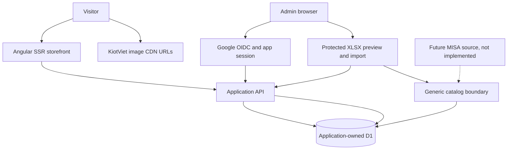

# Standalone Product Catalog — AI Agent Implementation Plan

**Status:** Phase 2 complete locally; production readiness pending; Phase 3 ready to start
**Last updated:** 2026-11-12
**Shop:** ThichMacDep
**Current catalog source:** manually exported KiotViet XLSX
**Future source:** MISA, product not selected; integration out of scope

## 1. Instructions for agents

This document is the source of truth for current scope. Earlier KiotViet API, authentication, synchronization, webhook, cron and R2 image-copy plans are superseded, not prerequisites for v1. Existing code or historical notes do not establish current requirements.

Work in small, testable phases; implementation is local only unless explicitly approved. Do not deploy, create cloud or production resources, configure external accounts, spend money, perform live Google login, or change external systems without explicit human approval. Keep credentials, local state and sensitive store exports out of Git, fixtures, logs and documentation. An ignored, uncommitted `.env` may retain legacy KiotViet values; do not modify or commit it. Use synthetic fixtures. Verify current version-specific library documentation before implementation. Report changed files, tests, limitations and human actions; never mark a human action complete without evidence.

## 2. Product scope

Build a mobile-first public product catalog with homepage, product and category listings, search by name/SKU, pagination, useful filtering, product details and variants, images, configurable contact links, and accurate SEO metadata. There is no cart, checkout, payment, shipping, orders, customer accounts or loyalty logic.

An authenticated administrator uploads a KiotViet XLSX export through a protected admin interface, previews validation and applies an import. Only rows classified **Hàng hóa** are eligible; **Dịch vụ** and other classifications are excluded and reported. The application owns normalized catalog data, stable IDs and website merchandising settings. The export is a snapshot, not a live connection: changes appear only after a subsequent successful manual import.

No KiotViet API access, API credentials, token handling, synchronization, webhooks, scheduled reconciliation, image downloads or R2 copies are required. MISA is not implemented; keep practical generic normalization and source-identity boundaries, without designing an assumed MISA API. A general-purpose admin dashboard is not required beyond authentication and catalog import.

## 3. Technology and rendering

- Angular v22, standalone and signal-first, with SSR for dynamic catalog pages; SSG is reserved for genuinely static pages. Use strict TypeScript and templates, typed forms and API contracts, modern template control flow, stable tracking keys, accessibility, and current Angular guidance. Prefer OnPush and immutable state.
- TypeScript and Hono API; Drizzle ORM and SQLite-compatible Cloudflare D1; pnpm workspaces. Workers is the intended deployment runtime, subject to the existing SSR compatibility gate. Develop with local Wrangler/workerd and local D1 by default.
- XLSX parsing runs in the admin browser using SheetJS; the API independently validates submitted JSON. Its compressed input and post-parse limits do not bound decompression or parsing memory, so a malicious workbook can hang or exhaust the browser. Do not assume spreadsheet cell types or rely on floating-point price arithmetic. Validate integer VND precisely; reject or report non-integral or invalid amounts rather than silently rounding. See `docs/xlsx-import-contract.md`.
- Images use validated direct KiotViet CDN URLs, not R2. Existing local R2 proof is historical, not a current dependency. No queues or scheduled triggers are needed.
- Store timestamps consistently in UTC, use SQLite-compatible schema/migrations, and isolate persistence sufficiently for future change without speculative abstractions.

## 4. Architecture and boundaries

The storefront consumes application-owned public read APIs, not a provider API. Import parsing and source-specific mapping are isolated from normalized catalog services and persistence. Source identities map to stable internal product and variant IDs; public URLs use application slugs, not provider IDs. Website-owned fields remain separate. Retire obsolete KiotViet API-specific code without removing generic boundaries that are genuinely useful for a future source. Do not add speculative MISA modules or assume that future source IDs match current codes.

## 5. Catalog data and import rules

The normalized model should support products, categories, variants, ordered images, source identity mappings, website product settings, store settings and import run summaries. Preserve existing internal IDs, stable slugs, variant identities and website settings across repeat imports. Source mappings must uniquely identify a source record at the appropriate product/variant level; validate duplicate or conflicting source codes before writing. Schema changes require justified versioned migrations and local tests.

1. Inspect the workbook and validate file type, size, sheet/column structure, row types and required fields. Report row-level errors and skipped non-goods counts without exposing sensitive workbook contents in logs. Use a bounded, deterministic preview before applying changes; document whether invalid rows block the entire import or are excluded, and never silently partially apply an ambiguous group.
2. Import only Hàng hóa rows. Normalize names, category, SKU, price, business flags, attributes and image URLs only where their semantics are understood. Treat missing and explicitly empty values deliberately; do not invent availability or inventory semantics.
3. Group variants only when evidence is consistent: for example `AK88-S`, `AK88-M`, `AK88-L` may form one product when each SKU suffix matches its SIZE attribute and the remaining grouping evidence is compatible. Validate duplicates and conflicts. Related product codes alone are not proof of a group. Report ambiguous or inconsistent groups for human review; do not guess or silently merge them.
4. Preview creates/updates, exclusions, conflicts and errors before an explicit administrator confirmation. Apply deterministically and safely, with failure reporting and transactional or otherwise documented partial-failure behavior. Reimporting the same file must not create duplicates or overwrite website-owned settings.
5. Absence from an upload must **never** automatically deactivate or delete existing products. Explicit source active/direct-sale flags may inform visibility only under documented, validated rules; ambiguous values must be reported. No assumption that an export is complete.
6. Keep a minimal import audit: actor, timing, status, counts and sanitized error summaries. Do not retain raw spreadsheets or sensitive rows unnecessarily. An upload must not modify the upstream system.

The available sample is sensitive, local-only and must not be committed or reproduced. Preview parsing reported 183 goods, 2 services, 73 product groups and 0 validation errors; no actual workbook import via admin has been run. It includes related codes, attributes and decimal-valued spreadsheet prices; these observations are not a universal schema guarantee. Use synthetic examples in tests and documentation.

## 6. Images

Store and return validated HTTPS KiotViet CDN image URLs directly, preserving ordering. The exact hosts are `cdn2-retail-images.kiotviet.vn`, `cdn1-retail-images.kiotviet.vn` and `cdn-images.kiotviet.vn`; reject unsafe or malformed URLs. Reconcile only XLSX-owned photos, preserving other sources' photos. Do not server-fetch URLs, proxy images, download binaries, create R2 objects or store image binaries in D1 in this phase. Display a useful fallback when an image fails.

External CDN URLs can expire, change, become unavailable or depend on access rights. They are not backups. The owner must maintain an independent image backup and accept this availability risk before launch. Image copying, durable application-controlled hosting, SSRF protections for any future fetcher, R2 configuration and associated costs require a separately approved future plan.

## 7. Authentication, authorization and write security

Use Google OpenID Connect for identity and an application-owned users/roles table for authorization. Link identities using Google's stable `sub`, not email alone; require a verified email and validate token signature, issuer, audience, expiry and nonce. Apply the applicable OIDC authorization flow and verify state, redirect URI and other required protections against current documentation. Google identity alone does not grant admin access: only an explicitly provisioned application user with the admin role may access the admin interface or perform writes. Document a secure, human-controlled bootstrap and revocation process; never auto-promote arbitrary Google users.

Use secure, HttpOnly, appropriately SameSite session cookies, secure transport outside local development, expiration and logout. Protect every state-changing endpoint against CSRF, including import confirmation and authentication flows as applicable; validate origin and use an appropriate anti-CSRF mechanism. Enforce authentication and admin authorization server-side for every write, not just in the UI. Validate upload size, type, workbook contents and all inputs; return safe errors and avoid logging tokens, secrets or sensitive export rows. Public endpoints remain read-only. No unauthenticated public write route exists.

Local tests use mock identity/OIDC and synthetic data. The owner configured Google OAuth and signed in locally. Local configuration uses ignored `.env`, with a manually provisioned initial local admin; an existing enabled admin can add another Gmail account in the UI. See `README.md` for setup. No external account or live login is required for offline tests. Production OAuth configuration and edge rate limits remain launch blockers.

## 8. Public API and storefront

Provide application-owned read endpoints for health, products, product detail, categories, category detail and store settings. Validate query parameters, cap pagination, return only active and website-visible products, use consistent errors and avoid leaking source mappings, import metadata or credentials. Search, category filtering and price/availability filters must reflect validated data. Use short, documented cache lifetimes or invalidation after imports.

Build responsive homepage, product listing, category and detail pages with loading, empty, error and image-fallback states. SSR must include meaningful content and appropriate titles, descriptions, canonical URLs, Open Graph, sitemap and robots rules. Emit structured product data only where accurate. Updates should appear on the next uncached render without a rebuild. Test accessibility and keyboard navigation. Confirm the Angular SSR build/runtime compatibility on Workers before deployment; do not silently substitute client-only rendering for SEO pages.

## 9. Local development and testing

Use local D1, migrations, synthetic XLSX fixtures and mocked Google identity. Keep `.wrangler/state`, `.env`, `.dev.vars`, secrets, local databases and actual exports ignored. Do not point local bindings to production. Verify actual parser, Angular, Hono, Drizzle and Cloudflare APIs against current version-specific docs before implementation.

Required automated coverage:

- Workbook structure, malformed files, file limits, missing columns, goods-only filtering, skipped services, duplicate codes, missing fields, exact VND conversion and invalid decimals.
- Valid SKU/SIZE variant grouping, inconsistent or ambiguous grouping and related-codes-only cases. Verify preview, confirmation, failure handling and useful reports.
- Repeat imports preserve product/variant IDs, slugs and website settings; absent products stay active; no duplicate records; explicit status handling follows documented rules.
- Image URL scheme/host validation and ordering, rejection of unsafe URLs, no server-side fetch, and UI fallback on broken CDN links.
- Mock OIDC verification and failure cases for signature, issuer, audience, expiry, nonce and unverified email; stable subject linking, unknown/non-admin denial, admin success, session expiry/logout and CSRF rejection on all writes.
- Public API pagination, search, category filters, hidden/inactive exclusion and no sensitive metadata leaks; SSR content, metadata, responsive behavior and accessibility.
- Local end-to-end journey: mock admin login, upload, preview, confirm, reimport and public rendering with local D1. No live Google, KiotViet or cloud account required.

Report test results and limitations honestly. Fresh-clone setup verification remains outstanding from Phase 0.

## 10. Human actions required

Agents may prepare instructions but must not perform account-level actions or deploy without explicit approval.

### HUMAN ACTION REQUIRED H1 — Google OAuth and administrator provisioning (deferred)

When live authentication is approved, the human creates/configures the Google OAuth client and consent screen, registers approved redirect URIs, securely supplies configuration without sharing secrets in chat, and explicitly provisions the initial application admin using the documented bootstrap procedure. Verify a real login only after approval. Local development uses mocks.

### HUMAN ACTION REQUIRED H2 — Catalog and presentation decisions

Supply or approve a representative export locally without committing it; confirm price, explicit active/direct-sale flag and ambiguous grouping semantics, visibility, currency, contact links and branding. Review import preview conflicts. Maintain independent image backups and acknowledge direct CDN URL expiry/availability risk.

### HUMAN ACTION REQUIRED H3 — Cloudflare and launch (deferred)

Only after local acceptance and explicit approval, the human decides on Cloudflare account, D1 and Worker resources, secrets, domain, backups, quotas, costs and deployment. Configure staging/production separately and validate SSR, HTTPS, authentication, imports and public image access. R2, cron and webhooks are not launch prerequisites.

### HUMAN ACTION REQUIRED H4 — Repository and CI/CD (deferred)

Approve repository access, secret management and separate preview/production deployment workflows. Review excluded sensitive files before any push and approve production launch.

## 11. Implementation phases and acceptance

### Phase 0 — Repository and architecture proof: complete with caveats

Local migration, D1/R2 smoke tests, health endpoint, Angular server-rendered sample route, and local Workers SSR/asset proof passed. Fresh-clone setup verification was owner-deferred; production deployment compatibility remains unverified. See `docs/phase-0-compatibility.md` and commit `ceeb3be`. The R2 proof is historical and does not make R2 part of the revised image architecture.

### Phase 1 — Normalized catalog and API: complete locally with caveats

The schema and migration, repeatable fixtures and read-only catalog API passed local integration tests for pagination, filtering, visibility, provider-ID separation and preservation of website settings. SQLite LIKE does not provide full Unicode case-insensitive search. The detail API now exposes validated direct CDN URLs. No production resources were created.

### Phase 2 — XLSX import and protected administration: COMPLETE LOCALLY

Manual goods-only XLSX preview and confirmed import, grouping, direct image URLs, import audit, application roles and protected Google admin sessions are implemented locally with synthetic tests. Partial variant status handling is fixed; missing products and variants are not deactivated. Category moves are rejected pending an ownership model, and photo reconciliation affects only XLSX-owned photos. Earlier local KiotViet API sync work is obsolete and was not live-validated; it does not satisfy this phase.

**Local verification:** The owner configured Google OAuth, signed in, imported the actual workbook through admin and confirmed the reimport works. Synthetic tests cover replay, grouping and settings preservation; local generated slugs were migrated to readable names with a backup. **Production blockers:** edge rate limits, deployed storefront/API same-origin routing and production Google OAuth configuration. The XLSX lock serializes cooperating XLSX writers, not concurrent non-XLSX catalog writers; do not run production multi-writer workloads until all writers are coordinated or equivalent database constraints exist. No KiotViet credentials, webhook, cron, R2 or cloud resources are required for local tests; no production resources have been created.

### Phase 3 — Storefront and SEO: pending

Implement Section 8, including direct-image failure fallback and accurate SSR metadata. Acceptance requires meaningful server-rendered content, tested responsive/accessibility behavior and imported updates visible without rebuilding, subject to documented cache TTL.

### Phase 4 — Deployment: deferred, human approval required

After local acceptance and H1–H4, validate deployment compatibility, configure approved Worker/D1 resources, secrets, domain, backups and monitoring, and run approved production smoke tests. Verify public pages, secure admin access, import flow and HTTPS image delivery. Document limits and costs. No R2, webhook or cron requirement.

### Phase 5 — Future MISA: out of v1

Only after the owner selects a product and approves work, research its actual capabilities and plan a dry-run identity mapping and rollback. Preserve internal IDs, website settings and the public contract. No MISA API or adapter is assumed now.

## 12. Operations and definition of done

Keep local, staging and production isolated. Store secrets only in ignored local files or approved secret management; never log authorization headers or credentials. Back up D1 before production reliance and maintain independent image backups. Monitor Worker and D1 usage and recheck quotas and pricing before launch. External image availability is outside application control.

V1 is ready for initial production use only when:

- [ ] An authorized admin can preview and import eligible Hàng hóa XLSX rows; validation, grouping and ambiguity reporting work as specified.
- [ ] Reimports preserve internal identities and website settings; missing rows never trigger automatic deactivation.
- [ ] Direct validated KiotViet CDN image URLs render with fallback, and the owner accepts expiry risk and maintains backups; no image copying is required.
- [ ] Google OIDC and application-owned admin roles protect every write, including CSRF protection; local mock tests pass and the human has approved and verified live configuration.
- [ ] Public catalog, search, categories, product details, contact links, SSR and SEO work without checkout or customer/order features.
- [ ] Local tests and fresh-clone instructions pass; limitations are documented.
- [ ] Production configuration, backups, costs and security are reviewed, and the human approves launch.

## 13. References

Verify current documentation and versions before implementation:

- Google OpenID Connect: https://developers.google.com/identity/openid-connect/openid-connect
- Angular SSR: https://angular.dev/guide/ssr
- Angular on Workers: https://developers.cloudflare.com/workers/framework-guides/web-apps/more-web-frameworks/angular/
- Workers local development: https://developers.cloudflare.com/workers/local-development/
- D1 local development: https://developers.cloudflare.com/d1/best-practices/local-development/
- Hono: https://hono.dev/
- Drizzle D1: https://orm.drizzle.team/docs/connect-cloudflare-d1
- SheetJS documentation: https://docs.sheetjs.com/

Historical Phase 2 KiotViet API notes, if retained, are not current implementation instructions. Phase 3 may begin locally; do not treat local acceptance as production acceptance.
